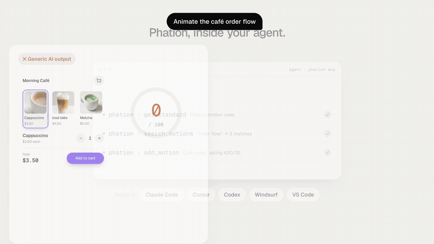

<p align="center">
  
</p>

<h1 align="center">Phation</h1>
<p align="center"><b>Give your AI taste in motion.</b><br>
Ready-made interactions and motion rules for your coding agent, so the motion it writes is right the first time, not the fifth.</p>
<p align="center"><a href="https://phation.app">phation.app</a> · <a href="https://www.npmjs.com/package/phation">npm</a> · <a href="#mcp-tools">MCP tools</a> · <a href="#the-phation-standard">Standard</a></p>

<p align="center"><a href="https://glama.ai/mcp/servers/pnhathuy09/phation"></a></p>

---

Ask an agent to "animate the add-to-cart flow" and you usually get hard cuts, linear easing, numbers that swap instead of roll, and nothing for reduced motion. Phation gives the agent two things:

- **The Phation Standard**: a short set of motion rules (springs, curves, durations, stagger, accessibility) that the agent loads in every session.
- **A library of real interactions** it can search, read and drop into your project: React + Motion components with their exact spring and timing values.

It runs as a free **CLI**, and with Phation Pro as an **MCP server** for Claude Code, Cursor, Codex, Windsurf and VS Code. A few components are free and MIT, in [`components/`](components).

## Install

```bash
# Free: the CLI
npx phation search "price counter"
npx phation add buy-morph          # a free component, no key needed

# Pro: the MCP server (Claude Code)
claude mcp add phation -e PHATION_KEY=<license-key> -- npx -y phation mcp

# Pro: Cursor · Windsurf · VS Code (MCP config)
{ "command": "npx", "args": ["-y", "phation", "mcp"], "env": { "PHATION_KEY": "<license-key>" } }
```

Node 18 or newer.

## The Phation Standard

Install the rules once per project. Every animation your agent writes then uses the same curves, springs, durations and accessibility handling.

```bash
npx phation init claude     # .claude/skills/phation/SKILL.md + a pointer block in CLAUDE.md
npx phation init cursor     # .cursor/rules/phation.mdc
npx phation init codex      # a marked section in AGENTS.md (your own content is kept)
npx phation init windsurf   # .windsurf/rules/phation.md
npx phation init vscode     # .github/instructions/phation.instructions.md
npx phation init all

npx phation standard springs   # print one section
```

Re-running `init` updates only Phation's own files and the block between the `phation:start` / `phation:end` markers. The rules are in [`data/standard`](data/standard).

A taste of what is inside: one spring family for the whole product.

| Spring | Stiffness · damping | Use for |
|---|---|---|
| snap | 420 · 32 | Controls |
| pop | 400 · 20 | Things appearing |
| soft | 170 · 22 | Surfaces |
| follow | 420 · 34 | The pointer |
| bounce | 160 · 14 | Celebrations |

## MCP tools

The MCP server is part of Phation Pro. Without a key it still starts and lists its tools, and each call answers with how to get a license.

| Tool | What it does |
|---|---|
| `get_standard` | The Phation Standard: the core rules, or one section |
| `install_standard` | Writes the rules into the project for the agent you use |
| `search_motions` | Finds interactions by what they should do or feel like ("calm bottom sheet", "make the price feel alive") |
| `list_motions` | Every interaction, optionally for one category |
| `get_motion` | Spec, `MOTION` values, dependencies and media of one interaction (about 200 tokens) |
| `add_motion` | Writes the component into your project |
| `animate_ui` | Animates your own screens: maps each part of a .jsx/.tsx file to a motion recipe under one Feel |
| `audit_motion` | Records a page frame by frame and scores its motion: layout jumps, low contrast, missing reduced motion |

Outputs are kept small on purpose: a typical "add a rolling price to the cart" task costs about 2.8k tokens end to end.

## CLI

```bash
npx phation list [category]          # browse
npx phation search <words>           # find by intent
npx phation show <slug>              # spec + MOTION values
npx phation init <agent>             # install the Standard
npx phation add <slug>               # write the component into src/motion (free entries: no key)
npx phation add --from "<studio link>"   # Pro: with the values you tuned in the Studio
npx phation audit <url> [--do click:#buy]   # Pro: score the motion of a page
npx phation animate <file|folder>    # Pro: plan motion for your own screens
```

## Free components

These ship with their full source under MIT. Use them, change them, ship them.

| Component | What it does |
|---|---|
| [`buy-morph`](components/BuyMorph.jsx) | Buy button that folds into a spinner, lands a check, then opens back into its label |
| [`hold-redeem`](components/HoldRedeem.jsx) | Hold to redeem: the fill grows while pressed and drains if you let go early |
| [`scroll-text-reveal`](components/ScrollTextReveal.jsx) | Each character brightens from grey to white as the paragraph scrolls up |
| [`nav-letter-roll`](components/NavLetterRoll.jsx) | Nav links whose letters roll up one by one on hover |

Each one needs `react` and `motion`. Add one with `npx phation add <slug>`, or copy the file.

## Free and Pro

| Free | Pro |
|---|---|
| The Phation Standard and `init` for every agent | The MCP server |
| `list`, `search`, `show`: specs and `MOTION` values | `add` for every component in the library |
| The free components, with source (MIT) | `audit` and `animate` |
| Explore and tune every interaction live at [phation.app](https://phation.app) | |

This repository contains the CLI, the MCP server, the Standard and the free components. **It ships no Pro component source**: with a license, `add` fetches it from phation.app. Plans are at [phation.app/pricing](https://phation.app/pricing).

```bash
npx phation login <license-key>    # saved to ~/.config/phation/license.json
# or, for CI and agent configs: PHATION_KEY=<license-key>
npx phation whoami
```

## License

The code in this repository is [MIT](LICENSE), including the free components. The Phation name and logo, the media, and the Pro components are not; see [NOTICE.md](NOTICE.md).

Made by [Pham Huy](https://phamhuyds.com).
